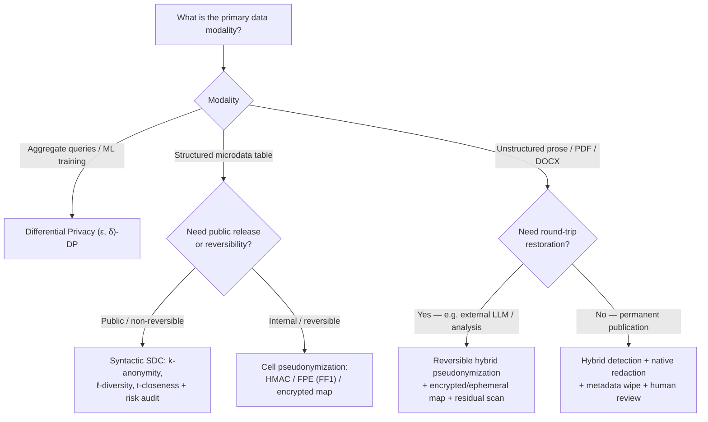

# Lecture 8: Choosing a Method — Decision Framework

No single privacy mechanism fits every workload. Choosing the wrong model either destroys data utility needlessly or delivers false security (for example, relying on regex masking for an open public release, or trying to apply differential privacy to a reversible legal contract review). This lecture synthesizes Lectures 1–7 into a practical selection framework.

---

## 1. Selection Flowchart

*Figure 1. High-level selection by data modality, release audience, and reversibility requirement.*

---

## 2. Method Matrix by Workload

| Workload | Primary Mechanism | Representative Open-Source Tools | Explicit Residual Risk |
|---|---|---|---|
| **Public release of tabular survey / clinical microdata** | Generalization & suppression ($k$-anonymity, $\ell$-diversity, $t$-closeness) + prosecutor/journalist risk audit | ARX Data Anonymizer, `sdcMicro` | High-dimensional linkage if $Q$ is incomplete; utility loss on rare strata. |
| **Large-scale aggregate telemetry or public statistics** | $(\varepsilon, \delta)$-Differential Privacy (Laplace / Gaussian mechanisms, privacy-budget accounting) | OpenDP, Tumult Analytics, Google DP | Noise degrades small-group counts; requires formal budget governance across queries. |
| **Database join keys / schema-constrained structured fields** | Keyed $\text{HMAC}_K$ or Format-Preserving Encryption (NIST FF1) with separated key management | Standard crypto libraries + KMS / vault | Deterministic equality & frequency remain visible; small domains weaken FPE. |
| **Sending contracts, notes, or reports to an external LLM and restoring answers** | Reversible hybrid pseudonymization (RE2 + local NER / local LLM) + encrypted or ephemeral mapping | `pdf-anonymizer`, custom Presidio + vault | Indirect contextual clues may persist; output remains personal data while mapping exists. |
| **Permanent publication of sanitized PDFs or Word filings** | Hybrid detection + content-stream glyph excision + metadata/layer/history stripping + human sign-off | `pdf-anonymizer --redact`, MAT2, native PDF redactors | Embedded raster images, indirect narrative context, and OCR errors still require human inspection. |
| **Training or fine-tuning an ML / LLM model on sensitive text** | Pre-training PII scrubbing + DP-SGD / deduplication + membership-inference testing | Scrubbing pipelines + Opacus / JAX-privacy | Scrubbing alone does not prevent memorization of non-PII identifying facts; DP-SGD reduces model utility. |

---

## 3. Common Engineering Anti-Patterns

| Anti-Pattern | Why It Fails | Recommended Correction |
|---|---|---|
| **Sending raw sensitive PDFs to a public cloud API in order to "anonymize" them** | Transfers raw personal data across the very trust boundary you sought to protect. | Run local detection first (RE2, local span NER, or local Ollama) or use an enterprise boundary with a signed DPA. |
| **Black-box PDF overlays without content-stream excision** | Text stays selectable and extractable beneath the rectangle (Lecture 5). | Excise glyphs from `/Contents`, wipe `/Info`/XMP/attachments, and rewrite without `/Prev` history. |
| **Unsalted `SHA-256` / `MD5` over SSNs, phones, or ZIP codes** | Trivially reversed via brute-force dictionary lookup (Lecture 6). | Use keyed $\text{HMAC}_K$ with a separated secret key, or randomized stand-ins. |
| **Evaluating only on synthetic benchmarks** | Masks severe recall drops on real-world quasi-identifiers and dates (Lecture 7). | Audit on domain-realistic corpora (e.g., TAB) and split metrics by direct vs. quasi-identifiers. |
| **Treating a tool flag as legal certification** | Software cannot know auxiliary datasets available to adversaries or organizational safeguards (Lecture 1). | Combine technical controls with documented risk assessment, access governance, and human review. |

---

??? note "Exercises"
    1. **Hospital ML dataset:** A hospital wants to publish a public tabular CSV of 50,000 hospital admissions (age, ZIP, admission month, diagnosis, cost) for a university machine-learning competition. No restoration is needed. Which mechanism family and risk metrics apply?
    2. **Legal contract review with external LLM:** A law firm wants to summarize 40 confidential PDF contracts using a hosted frontier LLM and insert the real party names back into the summaries locally. Why is $k$-anonymity inappropriate here, and what architecture fits?

    ??? note "Solutions"
        1. **Syntactic tabular SDC** (generalization/suppression to enforce $k$-anonymity and $\ell$-diversity / $t$-closeness over $Q = \{\text{age}, \text{ZIP}, \text{admission month}\}$ with $S = \text{diagnosis}$) paired with journalist/prosecutor risk auditing (e.g., ARX or `sdcMicro`), or differentially private synthetic/aggregate releases — plus formal HIPAA Expert Determination or Safe Harbor review.
        2. Contracts are unstructured prose requiring exact referential structure and round-trip restoration, which irreversible tabular generalization destroys. The right fit is **local reversible hybrid pseudonymization** (local regex + local NER/LLM) with typed placeholders (`PERSON_1`, `ORGANIZATION_1`), an encrypted or ephemeral local mapping, residual verification before sending text out, and local restoration of the returned summary.

*Next lecture: [Lecture 9 — System Case Study: `pdf-anonymizer`](how-different.md).*
