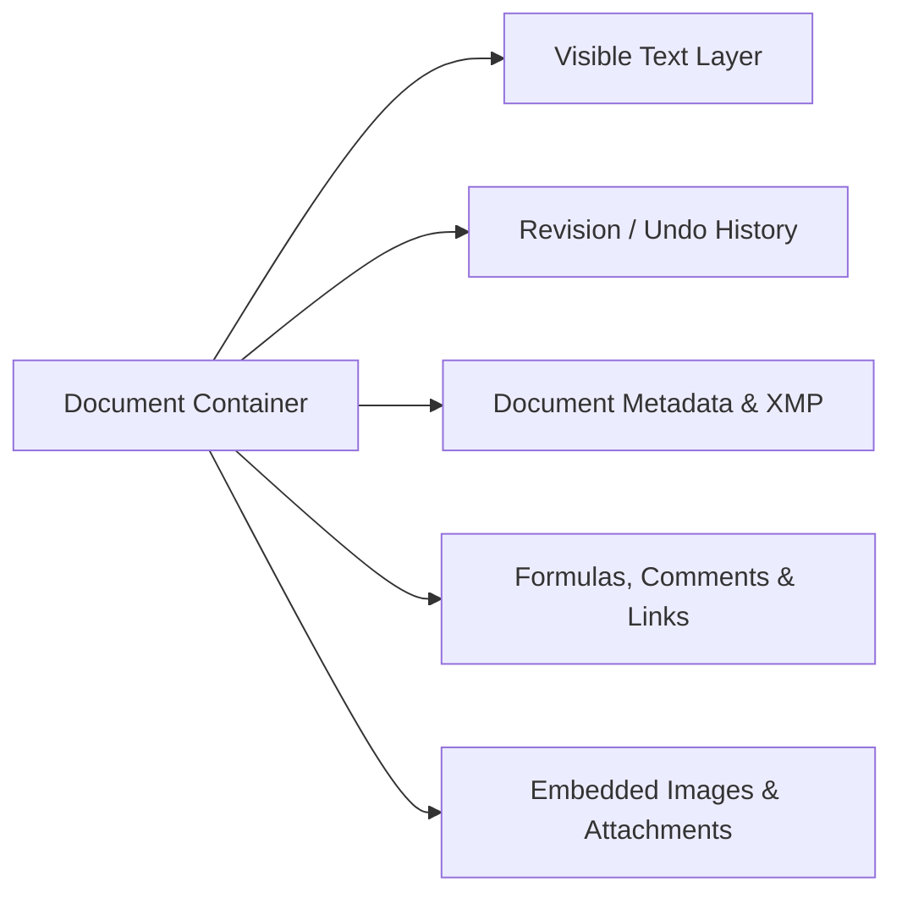

# Lecture 5: Document and File-Format Leakage

Text-level detection solves only half of document anonymization. Real-world document formats (PDF, `.docx`, `.xlsx`) are structured containers holding multiple layers beyond the pixels rendered on screen. A large share of high-profile public disclosure failures occur not because a detector missed a name, but because the **redaction or export step left hidden layers intact**.

*Figure 1. Container-level surfaces in modern office and PDF files. Modifying only the visible text layer leaves four independent leakage channels open.*

---

## 1. Portable Document Format (PDF / ISO 32000)

A PDF is an object graph composed of page content streams, fonts, annotations, metadata packets, and optional incremental update trailers:[^iso32000]

- **Overlay black boxes (the classic failure):** Drawing an opaque black rectangle annotation on top of text hides it visually while leaving the underlying glyph operators (`Tj`, `TJ`) untouched in the page `/Contents` stream. Anyone can copy-paste or run `pdftotext` to recover the redacted text verbatim. True digital redaction must **excise glyphs from the content stream** (or rasterize and rebuild pages for scanned documents).
- **Incremental save history (`/Prev`):** PDF editors frequently append edits to the end of the file rather than rewriting it. Previous cross-reference tables and unredacted page objects can survive inside the file bytes unless saved with a full garbage-collected rewrite (no incremental `/Prev` chain).
- **Metadata dictionaries and XMP:** The trailer `/Info` dictionary (`Author`, `Creator`, `Title`) and XML Metadata Packets (XMP) routinely record author usernames, organization names, and editing paths.
- **Hidden structural objects:** Embedded file attachments, Optional Content Groups (OCG / hidden layers), interactive form fields (AcroForms), annotations/sticky notes, and pre-rendered page thumbnails can preserve sensitive strings absent from main page text.
- **Image-embedded text and scans:** Scanned PDFs, embedded signatures, letterhead logos, and chart screenshots have no text layer. Text-only extractors either return empty output (silent failure) or skip embedded raster images completely; safe pipelines must fail closed on textless pages or run OCR / image sanitization explicitly.

---

## 2. Office Open XML Word Documents (`.docx` / ECMA-376)

A `.docx` file is a ZIP archive of XML parts (`word/document.xml`, `docProps/core.xml`, headers, footers, comments, and relationships):[^ecma376]

- **Split text runs (`w:t`):** Word arbitrarily breaks single words or email addresses across adjacent XML runs due to spell-check markers, revision IDs (`rsid`), or partial formatting (e.g., `<w:t>jane</w:t><w:t>@acme.com</w:t>`). Naive per-run regex matching misses split identifiers completely; detectors must concatenate visible paragraph text before locating spans.
- **Tracked changes (`w:del`) and comments:** Deleted text stored inside `<w:del>` elements and reviewer annotations in `word/comments.xml` remain inside the archive even when hidden in "No Markup" view.
- **Secondary XML parts:** Headers, footers, footnotes, endnotes, field codes (`w:instrText`), and relationship files (`word/_rels/*.rels`, which store `mailto:` and URL hyperlink targets) all carry identifiers outside `word/document.xml`.
- **Core properties and macros:** `docProps/core.xml` stores author and last-modified-by names. Legacy binary `.doc` and macro-enabled `.docm` files carry executable macros capable of reconstructing or exfiltrating values and should be rejected or converted before sanitization.

---

## 3. Spreadsheets (`.csv` and `.xlsx`)

Tabular files combine data-model hazards with container hazards:

- **Live formulas and cached values:** In `.xlsx`, a cell may display `"Alice Smith"` via `=A2` or `=CONCAT(B2," ",C2)`. Rewriting only display strings while leaving formulas intact allows recalculation to restore deleted names — or conversely, writing formulas referencing masked cells breaks downstream tables. Safe export writes **values only** (dropping formulas) and sanitizes formula-injection prefixes (`=`) in CSV exports.
- **Stored value vs. display format:** An Excel cell storing the integer `123456789` with custom display format `000-00-0000` appears on screen as an SSN, yet its underlying XML cell value is an unformatted integer. Running regexes over raw numeric cells causes severe false positives on quantities and IDs, while skipping them leaves formatted numeric identifiers undetected unless schema-aware or semantic rules run.
- **Non-cell surfaces:** Charts (embedded XML data caches), cell comments/notes, headers/footers, data-validation dropdown lists, defined names, pivot-table caches, and hyperlinks can retain copies of deleted rows.

---

## 4. Sanitization Summary by Format

| Format | Common Hidden Leakage Surfaces | Required Defensive Measures |
|---|---|---|
| **PDF** | Overlay redactions, `/Prev` history, `/Info` & XMP, attachments, OCG layers, annotations, raster images | Excise glyphs from content streams; full rewrite (`garbage` compaction); strip metadata, attachments, layers, and annotations; fail closed or OCR scans.[^nsa2008] |
| **Word (`.docx`)** | Split `w:t` runs, `w:del` deletions, comments, headers/footers, `w:instrText`, `_rels` hyperlinks, `core.xml`, macros | Join paragraph runs before detection; walk all XML parts and hyperlink targets; strip or reject tracked deletions, core properties, and macro-enabled formats (`.docm`). |
| **Spreadsheets (`.csv`, `.xlsx`)** | Live formulas, display-formatted integers, pivot caches, charts, comments, headers, defined names | Write cached values only (no formulas); neutralize CSV formula prefixes; inspect or strip charts, comments, headers, and pivot caches; reject macro workbooks (`.xlsm`). |

---

??? note "Exercises"
    1. **PDF redaction audit:** A colleague redacts a court PDF by drawing black rectangles in a PDF viewer and hitting "Save." Name **two** independent ways an adversary could still recover the hidden names from the resulting file.
    2. **DOCX XML trap:** Why does running an email regex directly on each `<w:t>` node in `word/document.xml` produce false negatives, and what hidden XML element can expose names the author previously deleted?

    ??? note "Solutions"
        1. (a) **Content-stream extraction:** The underlying text glyphs remain intact beneath the rectangle annotation and can be selected, copied, or extracted with any PDF text parser. (b) **Incremental `/Prev` history (plus metadata):** Even if text were later removed on a subsequent edit, a non-compacted incremental save retains prior page objects in the file trailer, and `/Info`/XMP may still name the parties or author.
        2. Word splits single strings across multiple `<w:t>` runs (e.g., on spellcheck or formatting boundaries), breaking per-run pattern matches. Previously deleted names survive inside tracked-change deletion nodes (`<w:del>`) unless changes are accepted/stripped.

*Next lecture: [Lecture 6 — Pseudonymization and Cryptographic Hygiene](pseudonymization-crypto.md).*

## References

[^iso32000]: ISO 32000-2:2020. *Document management — Portable document format — Part 2: PDF 2.0*. International Organization for Standardization. <https://www.iso.org/standard/75839.html>
[^ecma376]: ECMA-376 / ISO/IEC 29500. *Office Open XML File Formats*. Ecma International. <https://ecma-international.org/publications-and-standards/standards/ecma-376/>
[^nsa2008]: National Security Agency (2008). *Redacting with Confidence: How to Safely Publish Sanitized Reports Converted from Word to PDF* (Report I333-015R-2005); and NIST SP 800-88 / CISA document sanitization guidance.
