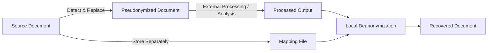

# Lecture 1: Problem Statement, Threat Models, and Legal Scope

Data sharing creates a structural tension between **utility** (retaining enough signal for analysis, research, or downstream computation) and **disclosure risk** (preventing an adversary from linking records back to real individuals). This lecture defines the core problem, reviews empirical re-identification attacks, and summarizes the main legal frameworks.

---

## 1. Anonymization, Pseudonymization, and De-identification

Three terms are frequently conflated in engineering discussions, although privacy law and literature distinguish them sharply (see also [Terminology](../project/terminology.md)):

- **Direct identifier:** An attribute that identifies an individual on its own (name, email address, Social Security number, account number, medical record number).
- **Quasi-identifier (indirect identifier):** An attribute that is non-unique in isolation but can isolate an individual when combined with other attributes or external knowledge (date of birth, postal code, sex, occupation, rare event or institutional role).
- **Irreversible anonymization:** Transforming data so that individuals can no longer be re-identified by any means reasonably likely to be used, including by the original data controller.
- **Pseudonymization:** Replacing identifiers with stand-ins (tokens, placeholders, or keyed hashes) while retaining separate mapping information that permits re-linking. Because the mapping exists, the output remains **personal data** under regulations such as the EU GDPR.
- **De-identification:** A general term (prominent in U.S. health law) for removing or transforming identifying attributes to reduce re-identification risk below a specified statutory or statistical threshold.

*Figure 1. Reversible document pseudonymization. The stand-in document crosses the trust boundary; the mapping key remains controlled locally.*

---

## 2. Adversary Models and Empirical Failures

Removing direct identifiers is necessary but rarely sufficient. In practice, re-identification attacks exploit auxiliary datasets and contextual uniqueness:

- **Linkage attacks:** Joining a released dataset with an external public or commercial table on shared quasi-identifiers.
- **Background-knowledge attacks:** Narrowing candidates using prior facts known about a target (for example, knowing a colleague visited a specific clinic in a given month).
- **Outlier profiling:** Isolating extreme or uncommon combinations (an unusual age, rare diagnosis, or unique job title within an organization).
- **Model memorization and extraction:** Recovering verbatim training examples — including personal names, phone numbers, and addresses — from generative language models trained on raw text.[^carlini2021]

Two foundational empirical studies established that naive identifier stripping fails on real data:

1. **Massachusetts GIC medical records (1997).** The Group Insurance Commission released hospital visit records with names and addresses removed. Latanya Sweeney purchased the Cambridge voter registration list (USD 20) and linked records on three quasi-identifiers — five-digit ZIP code, birth date, and sex — uniquely identifying the medical record of Governor William Weld.[^sweeney2002] Subsequent census analysis showed that 87% of the U.S. population was uniquely identified by those three attributes alone.[^sweeney2000] Later re-examination noted that real-world linkage rates depend on population coverage and sampling assumptions, but the core structural vulnerability remains.[^barthjones2012]
2. **Netflix Prize dataset (2008).** Netflix published 100 million movie ratings from 500,000 subscribers with subscriber IDs replaced by random numbers. Arvind Narayanan and Vitaly Shmatikov showed that sparse, high-dimensional behavioral records act as quasi-identifiers: knowing just a small number of rated titles and approximate dates from public IMDb profiles sufficed to re-identify individual Netflix users.[^narayanan2008]

Unstructured text amplifies this problem because quasi-identifiers appear in prose rather than fixed table columns. In *"the CFO who replaced John in April met with the Berlin office"*, removing *"John"* leaves an identifying description (*"CFO who started in April"* + *"Berlin office"*) that still isolates one person.

---

## 3. Legal and Regulatory Frameworks

Technical methods do not confer legal compliance by themselves; statutory definitions depend on context, auxiliary data availability, and governance controls.

| Framework | Jurisdiction & Scope | Core Standard for De-identification / Anonymization | Statutory Enforcement |
|---|---|---|---|
| **GDPR**[^gdpr] | European Union; personal data of natural persons | Recital 26 requires irreversibility considering all means *reasonably likely to be used*. Art. 4(5) classifies pseudonymization as a security safeguard; pseudonymized data remains personal data. | Administrative fines up to EUR 20M or 4% of global annual turnover. |
| **HIPAA Privacy Rule**[^hipaa] | United States; Protected Health Information (PHI) | Two statutory paths under 45 CFR § 164.514: **Safe Harbor** (removal of 18 specified identifier classes plus no actual knowledge of identifiability) or **Expert Determination** (documented statistical analysis showing very small risk). | Tiered civil penalties and criminal sanctions for intentional wrongful disclosure. |
| **CCPA / CPRA**[^ccpa] | California; consumer personal information | De-identified data is excluded only when it cannot reasonably be linked to a consumer and the business maintains technical safeguards and a public commitment not to re-identify. | Civil penalties up to USD 7,500 per intentional violation; private right of action for qualifying breaches. |

---

## 4. Application Domains

Disclosure risk arises wherever human records are shared across institutional or model boundaries:

| Domain | Typical Direct Identifiers | Typical Quasi-Identifiers / Context Clues | Primary Frameworks |
|---|---|---|---|
| **Healthcare** | Patient name, SSN, phone, medical record number | Admission dates, rare diagnoses, small geographic areas, clinician notes | HIPAA, GDPR |
| **Finance** | Account numbers, PAN / credit card, IBAN, tax ID | Exact transaction timestamps, merchant combinations, transfer amounts | PCI DSS, GLBA, GDPR |
| **Legal & Government** | Party names, case numbers, national IDs, addresses | Judgment dates, institutional roles, demographics, unique case facts | GDPR, court publication rules |
| **Academic Research** | Participant name, email, IP address | Survey combinations, demographic outliers, free-text responses | IRB protocols, open-data mandates |
| **Enterprise & LLM Workflows** | Customer names, employee logins, client accounts | Internal project names, org-chart roles, proprietary code or contract context | SOC 2, internal data governance |

---

*Next lecture: [Lecture 2 — Historical Development](history.md).*

## References

[^carlini2021]: Carlini, N., Tramèr, F., Wallace, E., et al. (2021). *Extracting Training Data from Large Language Models*. Proceedings of the 30th USENIX Security Symposium, 2633–2650. <https://www.usenix.org/conference/usenixsecurity21/presentation/carlini>
[^sweeney2002]: Sweeney, L. (2002). *$k$-Anonymity: A Model for Protecting Privacy*. International Journal of Uncertainty, Fuzziness and Knowledge-Based Systems, 10(5), 557–570. <https://doi.org/10.1142/S0218488502001648>
[^sweeney2000]: Sweeney, L. (2000). *Simple Demographics Often Identify People Uniquely*. Carnegie Mellon University, Data Privacy Lab Working Paper 3. <https://dataprivacylab.org/projects/identifiability/paper1.pdf>
[^barthjones2012]: Barth-Jones, D. C. (2012). *The 'Re-Identification' of Governor William Weld's Medical Information: A Critical Re-Examination of Health Data Identification Risks and Privacy Protections, Then and Now*. SSRN 2076397. <https://papers.ssrn.com/sol3/papers.cfm?abstract_id=2076397>
[^narayanan2008]: Narayanan, A., & Shmatikov, V. (2008). *Robust De-anonymization of Large Sparse Datasets*. IEEE Symposium on Security and Privacy (S&P 2008), 111–125. <https://arxiv.org/abs/cs/0610105>
[^gdpr]: Regulation (EU) 2016/679 (General Data Protection Regulation), Art. 4(5) and Recital 26. <https://gdpr-info.eu/>
[^hipaa]: U.S. Department of Health and Human Services (2012). *Guidance Regarding Methods for De-identification of Protected Health Information in Accordance with the HIPAA Privacy Rule*. <https://www.hhs.gov/hipaa/for-professionals/privacy/special-topics/de-identification/index.html>
[^ccpa]: California Consumer Privacy Act (CCPA) / California Privacy Rights Act (CPRA), Cal. Civ. Code § 1798.100 et seq. <https://oag.ca.gov/privacy/ccpa>
