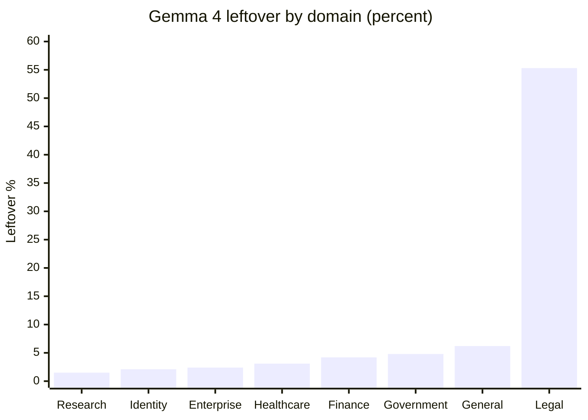

# Evaluation results

These numbers are one run of this package on a public [gold corpus](terminology.md#gold-corpus). They are not a ranking against other products, and they are not a HIPAA or GDPR certificate.

A **mention** is one labeled span of personal text. **Mention F1** balances how many of those spans were found and how many extra spans were marked. **Leftover** is the share of labeled mention text still visible after masking. Lower leftover is better. **Structured leftover** counts only emails, phones, cards, IBANs, and similar pattern identifiers. **Direct** identifiers name a person or an account. **Quasi-identifiers** are places, dates, organizations, jobs, and phrases that point at one person without a name.

The full run is package 0.31.0 on 6,761 documents (24 October 2026). The local model is `ollama/gemma4:12b-it-qat`, a quantization-aware 4-bit Gemma 4 with 11.9 billion parameters. That run is RE2 plus the detailed prompt, with thinking off, temperature 0, and a context of 8,192 tokens. Regex-only uses the patterns and no language model.

---

## Full corpus: regex and the local model

RE2 plus Gemma 4 cuts the leftover rate from 58% to 24%, and it raises mention F1 from 0.26 to 0.56. Structured leftovers fall from 3.9% to 0.1%. The gain is names and other free-text spans. The patterns already find most emails and account numbers.

```mermaid
xychart-beta
    title "Leftover on the full corpus (percent of labeled mentions still visible)"
    x-axis ["Gretel", "Presidio", "Court cases", "All 6,761"]
    y-axis "Leftover %" 0 --> 100
    bar "Regex only" [31.7, 74.9, 93.6, 57.6]
    bar "Gemma 4 local" [5.3, 7.1, 56.4, 24.1]
```

| Profile | Documents | Mention F1 | Direct F1 | Quasi F1 | Leftover | Structured leftover |
|---|---:|---:|---:|---:|---:|---:|
| Regex only | 6,761 | 0.262 | 0.293 | 0.235 | 0.576 | 0.039 |
| Gemma 4 local | 6,761 | 0.564 | 0.560 | 0.325 | 0.241 | 0.001 |

| Source | Documents | Regex leftover | Gemma leftover | Regex mention F1 | Gemma mention F1 |
|---|---:|---:|---:|---:|---:|
| Gretel (synthetic English) | 5,000 | 0.317 | 0.053 | 0.330 | 0.703 |
| Presidio synthetic | 1,500 | 0.749 | 0.071 | 0.199 | 0.622 |
| TAB court cases | 254 | 0.936 | 0.564 | 0.014 | 0.327 |
| Domain pack | 6 | 0.361 | 0.000 | 0.571 | 0.815 |

Court cases are the weak slice of this table. The next section says what that 56% actually is.

---

## Where the local model holds up

Leftover after the local run stays under 7% in every domain except legal. Legal here is mostly the 254 English court cases plus a few domain-pack pages.

| Domain | Documents | Mention F1 | Leftover |
|---|---:|---:|---:|
| Enterprise | 104 | 0.844 | 0.024 |
| Finance | 329 | 0.693 | 0.042 |
| General | 5,050 | 0.701 | 0.062 |
| Government | 231 | 0.627 | 0.048 |
| Healthcare | 507 | 0.671 | 0.031 |
| Identity | 121 | 0.677 | 0.021 |
| Legal | 323 | 0.332 | 0.553 |
| Research | 96 | 0.634 | 0.015 |

Healthcare leftover is 3.1%. Mention F1 there is 0.67, so some labeled spans are still missed or marked as the wrong kind, but most of the labeled text is no longer in the output.

---

## Why the legal number is not a name leak

The legal domain is 323 documents: 254 TAB court cases, 68 Gretel pages whose source label is `legal-documents`, and 1 domain-pack page. Offsets were checked against the document text. None of the 14,308 legal mentions disagree with their recorded span.

| Slice | Documents | Gold mentions | Leftover |
|---|---:|---:|---:|
| Gretel `legal-documents` | 68 | 286 | 0.042 |
| Domain-pack legal page | 1 | 6 | 0.000 |
| TAB court cases | 254 | 14,016 | 0.564 |

The domain rate of 0.553 is the court cases. Gretel’s legal pages behave like the other synthetic sets.

TAB marks a mention as direct or quasi separately from its type. On the 254 cases, direct leftover is 99 of 845 mentions (0.117). Quasi leftover is 7,803 of 13,171 (0.592). Dates are the mass:

| TAB type | Kind | Hidden | Still visible |
|---|---|---:|---:|
| Date | quasi | 69 | 5,331 |
| Demographic phrase | quasi | 549 | 1,873 |
| Person | quasi | 1,620 | 208 |
| Person | direct | 435 | 84 |
| Organization | quasi | 1,837 | 239 |
| Code or id | direct | 299 | 2 |

A date such as `29 November 1996` is still in the masked judgment. So are quasi phrases the annotators marked and the model did not emit: `Swedish`, `widows`, `two`, `son`. Of the 7,902 leftover mentions, 7,770 were never covered by a replacement at their own span. The other 132 were covered, and the string still occurs somewhere else in the case. Names and id codes in the same cases are mostly gone.

One regex does distort the court-case output without causing that leftover. The Canadian licence pattern includes `\b[A-Z0-9]{5,15}\b`. On these judgments it fires 1,459 times. `PROCEDURE` and `FACTS`, the section headings, become `DRIVERS_LICENSE_CA` on all 254 cases. Dates contain spaces, so this pattern does not hide them and does not create the 56% rate. It does add false predictions and rewrites headings.

---

## Same 82 documents: Gemma 4 and Gemini 4 Argon

Gemini 4 Argon was not run on all 6,761 documents. The sample is every mini-tab and domain-pack page, plus 25 documents from each of Gretel, Presidio, and TAB. The seed is `20261024`, so the draw can be repeated. Thinking was off (`thinking_budget` 0) and temperature was 0. The run made 82 calls, with no parse failures and no thinking tokens.

Read this chart against Gemma on **these 82 documents**, not against the full-corpus row above. The 82-document mix contains a larger share of court cases, so both leftovers are higher than the full-corpus Gemma figure of 24%.

```mermaid
xychart-beta
    title "Leftover on the same 82 documents (percent)"
    x-axis ["Domain pack", "Gretel", "Presidio", "Court cases"]
    y-axis "Leftover %" 0 --> 70
    bar "Gemma 4" [0, 7.3, 3.1, 57.5]
    bar "Gemini 4 Argon" [0, 7.3, 3.1, 49.7]
```

| Model on those 82 documents | Mention F1 | Direct F1 | Quasi F1 | Leftover | Structured leftover |
|---|---:|---:|---:|---:|---:|
| Gemma 4 local | 0.365 | 0.505 | 0.181 | 0.505 | 0.000 |
| Gemini 4 Argon | 0.416 | 0.330 | 0.268 | 0.438 | 0.000 |

| Source | Documents | Gemma mention F1 | Argon mention F1 | Gemma leftover | Argon leftover |
|---|---:|---:|---:|---:|---:|
| Domain pack | 6 | 0.815 | 0.897 | 0.000 | 0.000 |
| Gretel | 25 | 0.689 | 0.751 | 0.073 | 0.073 |
| Presidio | 25 | 0.658 | 0.693 | 0.031 | 0.031 |
| TAB court cases | 25 | 0.315 | 0.367 | 0.575 | 0.497 |
| Mini-tab | 1 | 0.909 | 1.000 | 0.000 | 0.000 |

Argon hides more of the labeled court text: leftover 0.497 against Gemma's 0.575 on the same 25 cases. Gretel and Presidio leftovers match. Argon's direct precision is 0.210 and its direct recall is 0.772, so it finds more direct spans and also marks many spans that are not direct identifiers. Gemma is the tighter direct detector on this sample (direct F1 0.505 against 0.330). Argon is ahead on quasi-identifiers (quasi F1 0.268 against 0.181).

---

## How to read a later run

The files behind these charts are `tests/eval/baselines/gold_corpus_regex_only.json`, `gold_corpus_local_detailed.json`, and `gold_corpus_closed_detailed.json`. `make gold-table` reprints the public table. The download and the commands are on [Gold corpus & eval](gold-corpus.md).
